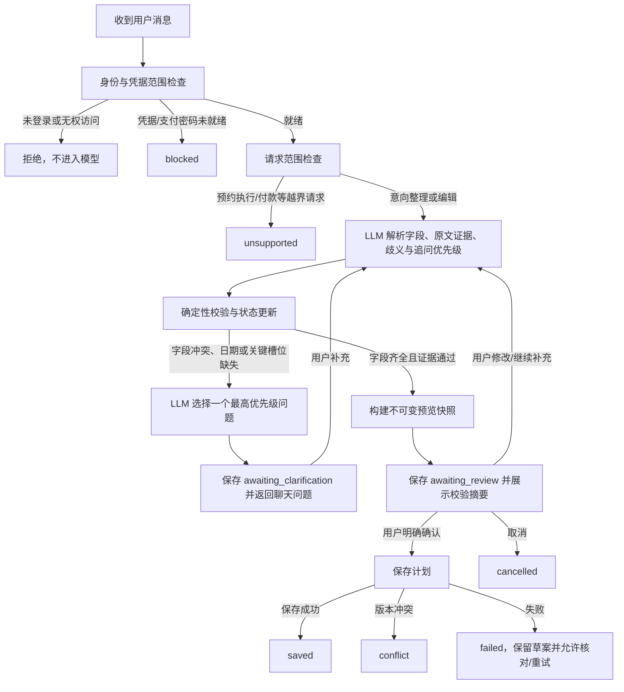

# AI 预约助手对话状态机设计

日期：2026-10-16  
范围：预约意向对话、澄清、预览、保存前校验  
建议编排：LangGraph 1.x；继续使用项目自己的模型 Provider 适配器

## 现状和问题

当前后端每轮把整段用户文本交给模型，要求模型返回 `ready` 或 `needs_input` 以及 1～5 个问题。以前端传来的问题历史只作为提示上下文，没有服务端状态记录哪些信息已被回答、哪个缺口最重要、用户当前处在审核还是等待回答。因此模型容易把日期、时间、时长、场馆、场地偏好在每一轮重新问一遍。

例如用户说“预约10号的”，助手应先消除“10号”是日期还是场地编号的歧义，不应同时问所有预约字段。

## 选型

采用 **LangGraph 状态图** 做有限、可审计的流程编排。流程需要条件分支、补问循环、人工审核节点和独立保存节点；这些正是 LangGraph 适用的控制流。Agent 仍通过 `AIProviderService` 调用当前 OpenAI-compatible Provider，不引入另一个模型 SDK，也不开放工具调用。

这不是多个自主 Agent。它是一个预约助手，由几个职责单一的节点组成。预约执行器继续留在独立服务中。

## 对话状态

持久化会话阶段：

| 状态 | 含义 | 允许的下一步 |
| --- | --- | --- |
| `collecting` | 已收到新意向或补充回答，正在解析 | 校验、澄清或生成预览 |
| `awaiting_clarification` | 只缺一个最高优先级问题 | 接收该问题的回答、取消 |
| `awaiting_review` | 全部必填字段和证据已通过校验，预览等待用户确认 | 确认保存、修改回答、取消 |
| `saving` | 保存请求已开始 | 保存成功、版本冲突或可恢复错误 |
| `saved` | 意向已保存 | 查看对话、开始新对话 |
| `blocked` | 凭据或支付密码检查未通过 | 前往凭据设置后重试 |
| `unsupported` | 请求超出“整理预约意向”范围 | 修改请求或开始新对话 |
| `conflict` | 编辑基准版本已变化 | 读取最新计划后重新整理 |
| `failed` | Provider、存储或输入校验发生可恢复错误 | 保留内容并重试，或取消 |
| `cancelled` | 用户取消当前对话 | 开始新对话 |

前端对应展示状态为：欢迎/输入、处理中、单条澄清、草案预览、保存中、已保存、设置阻塞、不支持、冲突和失败。刷新页面后从服务端恢复活动会话与最近对话。

## LangGraph 节点和转移

每次 HTTP 事件只向图中提交一个动作：`start`、`answer`、`confirm`、`cancel` 或 `retry`。图在需要用户输入或审核时返回并保存阶段，下一次用户操作从保存的阶段继续。图的会话 ID 由服务器生成；恢复任何阶段前先按当前登录用户和凭据范围检查所有权。

## Agent State 结构

图状态保存原始事实和结构化结果，不存放拼接后的提示词：

- 会话：`conversation_id`、`phase`、`version`、`created_at`、`updated_at`。
- 范围：新建/编辑模式、目标 `plan_id` 与 `base_version`、凭据范围引用。
- 对话：有序的用户消息和助手消息；当前轮次、问题槽位、已问槽位、重试次数。
- 槽位：日期、开始时间、时长、场馆、场地偏好、备用策略、可选价格上限。
- 每个槽位：规范值、状态（`unknown / provisional / explicit / ambiguous / conflicting / confirmed`）、原文引用、来自哪一轮、验证错误。
- 当前决策：LLM 返回的未解决槽位优先级、当前单条问题、短例子。
- 草案：严格校验后的 `PlanSnapshot`、审核版本、校验结果和保存幂等键。
- 轨迹：公开阶段事件和安全错误码；不保存或返回模型隐藏推理。

预约 Token、支付密码、API Key、Cookie 和上游请求头/请求体不进入模型输入或 Agent State。凭据服务只负责在调用模型前返回就绪/阻塞状态。Provider API Key 继续由现有 Provider 服务解密和使用。

## LLM 职责与优先级

每轮一次结构化解析，输出字段值、逐轮原文证据、冲突/歧义、未解决槽位排序，以及一条建议追问。模型可以根据上下文调整同优先级问题的顺序，并生成自然、简短、有例子的提问；模型不负责最后判定计划是否可保存。

服务端应用以下硬优先级：

1. 先澄清会改变含义的歧义（如“10号”可能是日期，也可能是场地编号）和目标日期。
2. 再确认开始时间与时长。
3. 再确认场馆。
4. 最后确认场地顺序及备选范围。

每轮只返回一个未解决槽位。已被用户明确回答的槽位不可重新提问。若回答仍模糊，针对同一槽位换成更明确的问法；连续两次仍无法确认时，提示用户使用绝对日期/具体时间或转人工表单。

简短示例：

- 日期：“你说的10号是几月几日？例如10月20日。”
- 时间：“你想几点开始？例如18:00。”
- 时长：“计划打多久？例如2小时。”
- 场馆：“想去哪家场馆？例如东区体育馆。”
- 场地：“哪些场地优先？例如6号场优先、5号场备选。”

## 计划有用性的保存门槛

只有以下条件全通过，图才进入 `awaiting_review`：

1. 目标日期是有效、明确、未过期的日历日期；相对日期使用服务端业务日期解释。
2. 开始时间为合法 `HH:MM`，时长为 30～240 分钟且 30 分钟递增，组合后不跨午夜。
3. 场馆文字来自用户原文；禁止模型创造场馆名或上游场馆 ID。
4. 用户明确列出场地偏好顺序，或明确允许同场馆任意场地；不得擅自增加场地或时间浮动授权。
5. 每个必需字段都有可验证的用户原文证据；有冲突、推断或歧义时继续澄清。
6. 服务端 `parse_manual_intent` 创建 canonical snapshot；前端再做同等格式和时间范围检查，作为额外防线。
7. 用户看到预览和校验摘要后明确点击确认。编辑操作用计划版本 CAS；重试保存使用幂等键。

这些校验保证保存的是结构完整且有用户依据的意向草案；它们不保证未来一定有真实场地，也不等于完成预约。当前 Agent 的 `PlanService.create_plan` 保存的是 `unbound_draft`，不会直接生成抢票队列或执行任务。真实场地查询、候选队列复核和预订执行仍走独立的执行服务。

## 与抢票执行状态机的边界

Agent 状态机终点是 `saved`。每日 D+2 的队列复核、07:30 校准、三轮预约流程、支付与回查属于 `BookingScheduler` / `BookingExecutionEngine`，保留它自己的运行状态与失败恢复。Agent 图没有这些工具，也没有权限跳过用户确认后创建执行任务。

## 可观测性

每轮记录允许用户查看的阶段轨迹：收到消息、提取到哪些明确字段、哪些字段缺失/冲突、为什么先问该字段、校验通过或失败、预览生成、用户确认、保存结果。只记录安全摘要和错误码，不显示模型隐藏推理、凭据值或上游响应原文。

## 实施顺序和验收

1. 添加 `planning_conversations`、`planning_conversation_turns` 和事件/版本迁移；所有读取按 `user_id + credential_id` 隔离。
2. 在 `backend/ai` 新建 LangGraph 状态图和会话服务，旧提案接口在迁移期间做兼容层。
3. 新增 start/answer/confirm/cancel/list/load API；所有写请求校验 CSRF、会话所有权、会话版本和幂等键。
4. 前端改用服务端会话 ID，展示一个追问、最近对话、简短示例、审核摘要和恢复错误状态。
5. 用合成 Provider 和隔离 SQLite 验证：优先级、单问、无重复、用户隔离、模型失败恢复、确认后才写入、重复确认不重复建计划、编辑 CAS 冲突、重载恢复。
6. 用 Codex 内置浏览器验证桌面与窄屏聊天界面；不触发真实预约或支付。

选型依据：LangGraph 当前文档将它定位为可混合确定性步骤与模型步骤的状态编排运行时，支持分支、循环和人工审核；本项目不需要 Deep Agents 的文件系统、规划工具或子代理能力。参考 [LangGraph overview](https://docs.langchain.com/oss/python/langgraph/overview)、[Thinking in LangGraph](https://docs.langchain.com/oss/python/langgraph/thinking-in-langgraph) 和 [Human-in-the-loop interrupts](https://docs.langchain.com/oss/python/langgraph/interrupts)。
